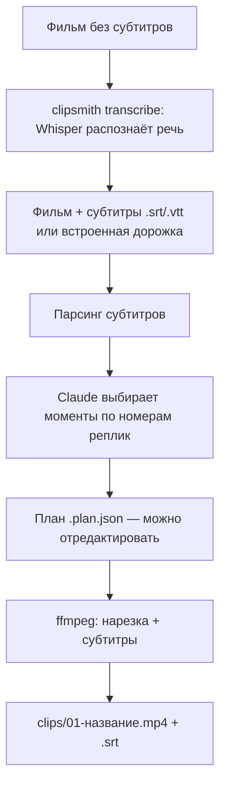

# clipsmith

Нарезка клипов с субтитрами из фильмов. Claude читает субтитры, выбирает лучшие моменты
(шутки, цитаты, повороты сюжета), а `ffmpeg` вырезает их и вшивает субтитры.

## Как это работает



## Установка

Нужны Python 3.10+ и `ffmpeg`.

```sh
python -m venv .venv && . .venv/bin/activate
pip install -e '.[transcribe,music,dev]'   # распознавание речи и поиск музыки
export ANTHROPIC_API_KEY=sk-ant-...   # или строка ANTHROPIC_API_KEY=... в файле .env
```

## Использование

```sh
# 0. Если субтитров нет — распознаём речь в movie.srt рядом с видео
clipsmith transcribe movie.mkv --language ru

# 1. Claude предлагает клипы и сохраняет план в movie.plan.json
clipsmith suggest movie.mkv -n 5 --theme "самые смешные диалоги"

# 2. Рендерим все клипы или только выбранные
clipsmith render movie.mkv --plan movie.plan.json --only 1,3

# Или всё сразу: моменты без оригинальной музыки + свои треки из папки
clipsmith run movie.mkv --movie "Название" --music ~/Music/free/

# Ручная нарезка: момент выбираете вы, Claude пишет только название и описание
clipsmith cut movie.mkv --start 01:02:03 --end 01:03:10 --title "финал" \
    --hint "герой узнаёт, что его предали"

# Название и описание для уже готовых клипов (берёт .srt рядом с клипом)
clipsmith describe clips/*.mp4 --movie "Название сериала"
```

### Название и описание для Shorts

Рядом с каждым клипом появляется `.txt`: название, два запасных варианта для A/B-теста
названий YouTube и описание с хэштегами, готовые для вставки. В `suggest`/`run` Claude пишет их
вместе с выбором моментов, и они сохраняются в плане (поля `shorts_title`, `alt_titles`,
`description`, `hashtags`), их можно поправить до рендера. Правила: цепляющее начало,
40–60 символов без спойлеров и без обмана, вопрос в описании ради комментариев, 3–5 хэштегов
с `#shorts`.

Claude видит только субтитры, не картинку. Для сцен, где главное происходит без слов,
опишите его через `--hint`. С `--movie` в текстах и хэштегах появится название фильма:
по нему ищут чаще всего. Без ключа API или с `--no-meta` клипы рендерятся без `.txt`.

По умолчанию клипы вертикальные, 1080×1920 (YouTube Shorts, Reels, TikTok), в режиме
`blur`: картинка 3:4 сдвинута вверх поверх размытого фона: сверху полоса 120 px,
снизу 360 px. Нижняя полоса уходит под название и описание Shorts, а субтитры
остаются на самой картинке.

### Музыка

`suggest` и `run` выбирают моменты, где в оригинальной дорожке нет музыки. Звук фильма
один раз прогоняется через классификатор звуков AudioSet (AST, ONNX, ~90 МБ, только CPU), результат
кэшируется в `movie.music.json`. Claude видит реплики под музыку с пометкой ♪ и список
«тихих» окон; клипы, где музыки больше `--max-music` (15%), отбрасываются.

```sh
clipsmith scan-music movie.mkv         # где есть музыка и какие куски свободны (45 мин ≈ 6 мин)
```

`--music track.mp3` (или папка — треки идут по очереди) кладёт свою музыку под диалог:
трек зацикливается, плавно появляется и затухает, а под репликами автоматически притихает
(sidechain-компрессия). Громкость диалога выравнивается до ≈ −16 LUFS (фильмы сведены тихо,
около −25), музыка ставится на `--music-level` дБ ниже диалога (по умолчанию −10). Если
рядом с треком лежит `track.txt`, его текст (атрибуция, например для CC BY) добавляется в
описание Shorts.

Где брать музыку: фонотека YouTube (YouTube Studio → «Фонотека») —
самый безопасный вариант для YouTube (часть треков требует атрибуции — кладите её в `.txt`);
музыка под CC0/CC BY. С сервисами вроде Pixabay аккуратнее: часть треков там зарегистрирована
в Content ID третьими лицами.

### Распознавание речи

`clipsmith transcribe` делает субтитры через [faster-whisper](https://github.com/SYSTRAN/faster-whisper)
(модель `large-v3-turbo`, ~1.6 ГБ, скачивается при первом запуске). Речь режется на
короткие субтитры в стиле Shorts по таймингам отдельных слов. На 8-ядерном CPU 45 минут
видео распознаются примерно за 7 минут. Распознавание не идеально: перед рендером
стоит поправить `.srt` вручную. Опции: `--model`, `--audio-stream`, `--start`/`--end`,
`--max-chars`.

Субтитры ищутся так: `--subs`, потом файл `.srt`/`.vtt` с тем же именем рядом с видео,
потом встроенная текстовая дорожка (`--subs-stream N`). Субтитры-картинки (PGS/VobSub)
не поддерживаются.

### Основные опции

| Опция | По умолчанию | Описание |
|---|---|---|
| `-n, --count` | 5 | Сколько клипов искать |
| `--min-duration` / `--max-duration` | 20 / 90 | Длина клипа в секундах |
| `--theme` | — | Что искать: «цитаты», «экшен», «романтика»… |
| `--language` | язык субтитров | Язык названий и описаний |
| `--model` | `claude-sonnet-5-5` | Модель Claude (или `CLIPSMITH_MODEL`) |
| `--music` | — | Свой трек или папка с треками |
| `--music-level` | −10 | Громкость музыки относительно диалога, дБ |
| `--max-music` | 0.15 | Допустимая доля оригинальной музыки в клипе |
| `--allow-music` | выкл. | Не избегать моментов с музыкой |
| `--movie` | — | Название фильма/сериала для названия и хэштегов |
| `--hint` | — | `cut`/`describe`: что происходит в кадре |
| `--no-meta` | выкл. | Не писать название и описание |
| `--subs-mode` | `burn` | `burn` (вшить), `soft` (отдельная дорожка), `none` |
| `--layout` | `blur` | `blur`: 3:4 сверху на размытом фоне; `fit`: весь кадр 16:9 на размытом фоне; `crop`: 9:16 с обрезкой по центру; `original`: исходные пропорции |
| `--padding` | 0.5 | Запас в секундах до и после клипа |
| `-o, --out` | `clips/` | Папка для результатов |

## Разработка

```sh
pytest
```
