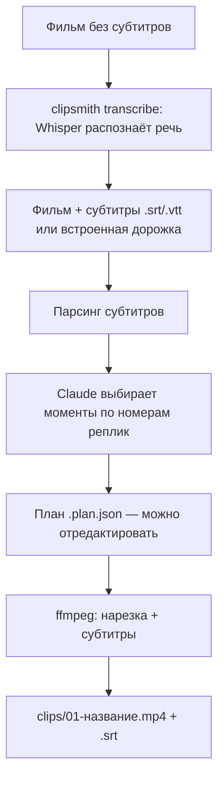

# clipsmith

Нарезка клипов с субтитрами из фильмов. Claude читает субтитры, выбирает лучшие моменты
(шутки, цитаты, повороты сюжета), а `ffmpeg` вырезает их и вшивает субтитры.

## Как это работает



## Установка

Нужны Python 3.10+ и `ffmpeg`.

```sh
python -m venv .venv && . .venv/bin/activate
pip install -e '.[transcribe,dev]'   # transcribe — распознавание речи, необязательно
export ANTHROPIC_API_KEY=sk-ant-...
```

## Использование

```sh
# 0. Если субтитров нет — распознаём речь в movie.srt рядом с видео
clipsmith transcribe movie.mkv --language ru

# 1. Claude предлагает клипы и сохраняет план в movie.plan.json
clipsmith suggest movie.mkv -n 5 --theme "самые смешные диалоги"

# 2. Рендерим все клипы или только выбранные
clipsmith render movie.mkv --plan movie.plan.json --only 1,3

# Или всё сразу; весь кадр 16:9 на размытом фоне
clipsmith run movie.mkv --subs movie.ru.srt --layout fit

# Ручная нарезка без AI
clipsmith cut movie.mkv --start 01:02:03 --end 01:03:10 --title "финал"
```

По умолчанию клипы вертикальные, 1080×1920 (YouTube Shorts, Reels, TikTok), в режиме
`blur`: картинка 3:4 сдвинута вверх поверх размытого фона: сверху полоса 120 px,
снизу 360 px. Нижняя полоса уходит под название и описание Shorts, а субтитры
остаются на самой картинке.

### Распознавание речи

`clipsmith transcribe` делает субтитры через [faster-whisper](https://github.com/SYSTRAN/faster-whisper)
(модель `large-v3-turbo`, ~1.6 ГБ, скачивается при первом запуске). Речь режется на
короткие субтитры в стиле Shorts по таймингам отдельных слов. На 8-ядерном CPU 45 минут
видео распознаются примерно за 7 минут. Распознавание не идеально: перед рендером
стоит поправить `.srt` вручную. Опции: `--model`, `--audio-stream`, `--start`/`--end`,
`--max-chars`.

Субтитры ищутся так: `--subs`, потом файл `.srt`/`.vtt` с тем же именем рядом с видео,
потом встроенная текстовая дорожка (`--subs-stream N`). Субтитры-картинки (PGS/VobSub)
не поддерживаются.

### Основные опции

| Опция | По умолчанию | Описание |
|---|---|---|
| `-n, --count` | 5 | Сколько клипов искать |
| `--min-duration` / `--max-duration` | 20 / 90 | Длина клипа в секундах |
| `--theme` | — | Что искать: «цитаты», «экшен», «романтика»… |
| `--language` | язык субтитров | Язык названий и описаний |
| `--model` | `claude-sonnet-4-5` | Модель Claude (или `CLIPSMITH_MODEL`) |
| `--subs-mode` | `burn` | `burn` (вшить), `soft` (отдельная дорожка), `none` |
| `--layout` | `blur` | `blur`: 3:4 сверху на размытом фоне; `fit`: весь кадр 16:9 на размытом фоне; `crop`: 9:16 с обрезкой по центру; `original`: исходные пропорции |
| `--padding` | 0.5 | Запас в секундах до и после клипа |
| `-o, --out` | `clips/` | Папка для результатов |

## Разработка

```sh
pytest
```
